# 课程调整操作说明

给「学科负责人」和「总务」。讲的是：课程要改的时候，谁在哪里点什么、点完会看到什么。

- **我是学科负责人**（管课程、排班课的人）：看左边目录「学科负责人」下面的各项。
- **我是总务**（在排课系统里排教室的人）：看左边目录「总务」下面的各项。
- 两个人都建议先看「先看这个：两个阶段，谁改什么」和「改了之后，哪里会变」。

文中的按钮名和提示文字，都是照系统里现在的样子写的。截图里的课程、老师都是虚构的示例。写着「待确认」的地方，是还没有核实清楚的行为，以实际为准。

---

## 一、先看这张图：改课程，分两个阶段

先说几个词：

- **课程**：管理端「课程安排」里的一门课。
- **这一回**：课程里的某一次上课（例如第 4 回，11/24）。
- **教室占用**：排课系统里，这门课用哪间教室、什么时候用。
- **课程安排**：管理端的页面，学科负责人在这里改课程。
- **排课系统**：总务用的页面，在这里排教室。

| | 开课前（建好课程后，到第一回上课前） | 开课后（已经有一回上过了） |
|---|---|---|
| 改什么 | 整门课的安排：每周几上、开课日、回数、上课时间、老师 | 只改某一回：改日期 / 时间、休讲、换老师、换教室 |
| 在哪里改 | 管理端「课程安排」点课程卡片上的「编辑」。排课系统「课程管理」也能改，但只限开课前的课 | 管理端「课程安排」里，点那一回格子上的按钮 |
| 改完后 | 系统按新规则重新排好每一回，教室要重新确认 | 只动这一回，教室跟着这一回走 |
| 谁来改 | 学科负责人 | 学科负责人 |

**分工只有一句话：日期、时间、休讲、老师，由学科负责人在「课程安排」里改；教室，由总务在「排课系统」里排。总务不能改日期和休讲；教室实在排不了，总务把情况反馈给负责人，由负责人去调整。**

怎么判断一门课是「开课前」还是「开课后」：

- 管理端「课程安排」：这门课的每一回都还没到，而且没有休讲、没有单独改过，算开课前。
- 排课系统「课程管理」：只要有一回的日期已经过去，就算已开课。
- 两边的判断不完全一样（例如开课前就已经有休讲或改过日期的课），遇到这种课，以管理端为准（待确认）。

---

## 二、学科负责人：开课前

### 2.1 新建课程后，总务怎么知道要排教室

**什么时候用**：新建了一门需要教室的课。

**步骤**

1. 管理端 → 「课程安排」→ 右上角「＋ 手动添加」（系列课点「＋ 新建系列课」）。
2. 填课程名称、领域、专业、讲师、校区、授课形式、星期、上课时间、课程回数、第一回日期。
3. 点「保存并生成课次」。

**做完后会看到**

- 弹出「课程已建立，请核对」，列出每一回的日期、跳过的假期。没问题点「没问题」，想改点「回去改」。
- 这门课的卡片上有一行小字「未排教室」。

**总务怎么知道**

- 系统**不会**自动通知总务。总务首页的「排课提醒」，在**开课前 45 天内**才会出现这门课：
  - 距开课还远：`【2026年10月期】距开课约 19 天，有 1 门课未排教室，请及时安排。`
  - 距开课 15 天内：`距开课仅 N 天，还有 N 门课未排教室，请于开课前完成！`
  - 已经开课：`已开课，仍有 N 门课未排教室，请尽快补排！`
- 所以：**校区一定要选对**（总务按校区挑教室）。课程开课前不到 45 天时，建议直接告诉总务一声。

**注意**

- 你不需要去排课系统里做任何事。
- 线上课还要总务另外设置腾讯会议，也由总务处理。

### 2.2 开课前，改整门课的安排

**什么时候用**：还没开课，要改每周几上、开课日、回数、上课时间或老师。

**步骤**

1. 管理端 → 「课程安排」→ 找到那门课，点卡片上的「编辑」。（图 ② 处）
2. 在编辑窗口里改要改的项目：① 星期、② 上课时间、③ 课程回数、④ 第一回日期、⑤ 讲师。
3. 点窗口底部的「保存并生成课次」。

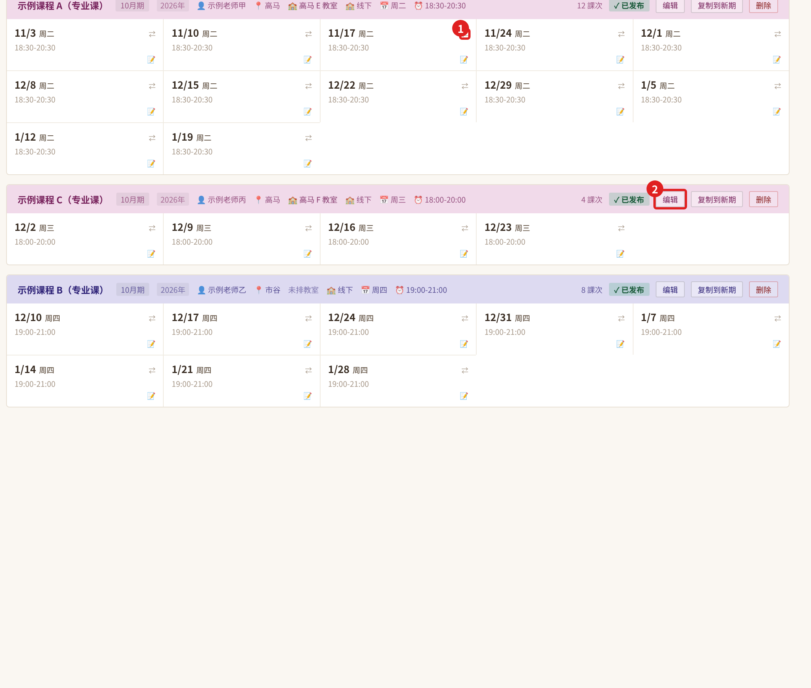

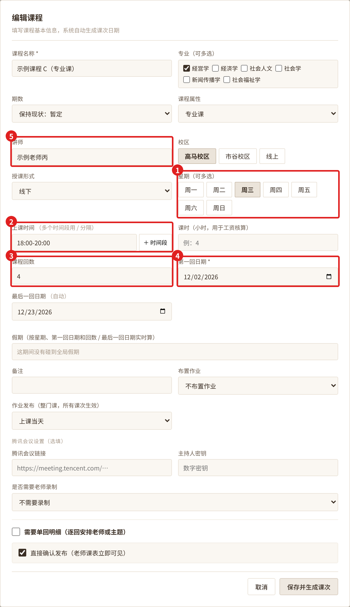

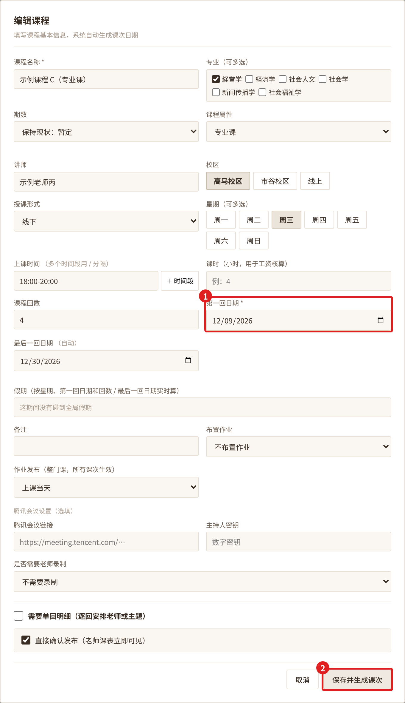

**做完后会看到**

- 开课前的课，每一回会按新的规则自动重排（日期、回数都会跟着变）。
- 如果新日期原来的教室是空着的：页面最上面浮出一条绿色提示，例如 `已改：第 1 回 → 12/9（三）18:00，原教室 F 教室 空着 ✓`。什么都不用做。
- 如果原来的教室被别的课占着，或者这门课还没有排教室：弹出「这几回的教室需要处理」（处理办法见 3.4）。
- 最后弹出「课程已修改，请核对」，没问题点「没问题」。

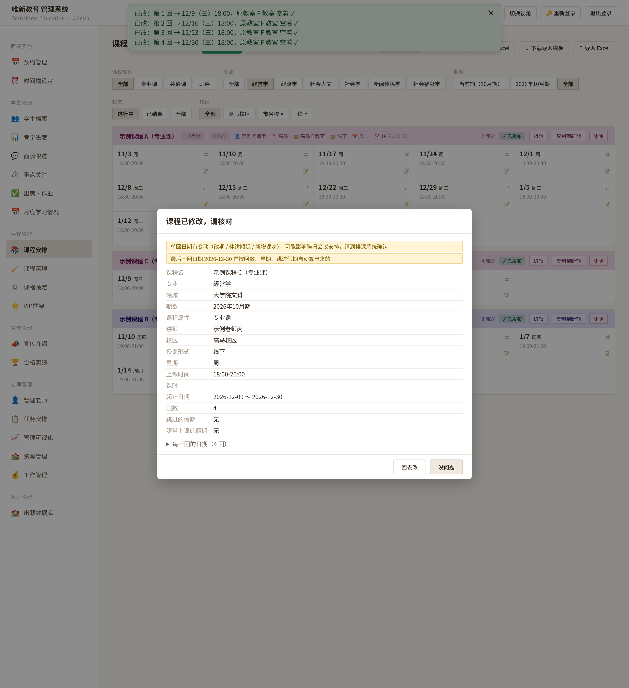

**注意**

- **已经排好教室的课，整门课的安排改了以后，总务排好的每周教室记录不会自动跟着改。请告诉总务：到排课系统「排教室」里确认或重排。**
- 如果只改了「上课时间」，保存后还会有黄字提醒：`课程时间改成 … 了，排课里的每周教室占用还是 …，请到排课调整`。同样请告诉总务。
- 这门课还没排教室时，编辑保存后「这几回的教室需要处理」会把每一回都列一遍，写着「这门课还没排教室」。直接点「完成」就行，什么都不会写。
- 排课系统「课程管理」里，总务也能改开课前课程的周几、开课日、回数；课程名、老师、专业在那里是灰色的，要改请回管理端。

### 2.3 回数审查（排课系统「课程管理」）

**什么时候用**：想检查受假期或休讲影响、结课日可能不对的课。这个功能在排课系统里，总务和有权限的负责人都能用。

**步骤**

1. 排课系统 → 「课程管理」。
2. ① 「开课状态」下拉可选「未开课」「已开课」「全部」，默认看未开课的课。
3. ② 点「回数审查」。
4. 看表格：课程、回数、开课日、当前结课日、命中假期/休讲、应有结课日。
5. ③ 不对的行（标「需调整」）操作列有按钮「改回数 / 周几 / 开课日」，点进去改。

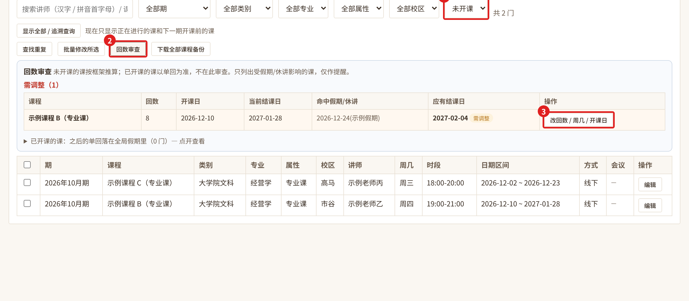

**怎么读**

- 「命中假期/休讲」：这门课原本该上课的哪几天遇到了假期或休讲，所以结课日要往后推。
- 「应有结课日」：按周几、回数、假期推算出来的结课日；和「当前结课日」不一样，就是「需调整」。
- 回数审查**只审开课前的课**。已开课的课以每一回的实际日期为准，不在这里审；已开课的课如果之后的某一回落在假期里，会列在下面折叠的「已开课的课：之后的单回落在全局假期里」里，仅作提醒。

**注意**

- 点「改回数 / 周几 / 开课日」后，保存时系统会按新规则重排这门课的每一回；已开课的课这里是只读的，要去管理端「课程安排」按这一回改。
- 目前回数审查里**没有**「去调整」「通知管理端」按钮（待确认，见文末核对清单）。

---

## 三、学科负责人：开课后，改某一回

### 3.1 这一回改日期 / 时间

**什么时候用**：某一回要换一天上，或者当天换个时间。回数、内容、老师都不动。

**步骤**

1. 管理端 → 「课程安排」→ 找到那门课、那一回的格子。
2. 点格子右上角的「⇄」（提示文字「调整日期」）。（图 ①）
3. 在弹出的「休讲调整」窗口里，点 ①「改到别的日期」。
4. 填 ②「新日期」、③「新时间」，选「休讲原因」（老师请假 / 学生原因 / 假期/节日 / 其他），备注可不填。
5. 点 ④「确认改日期」。

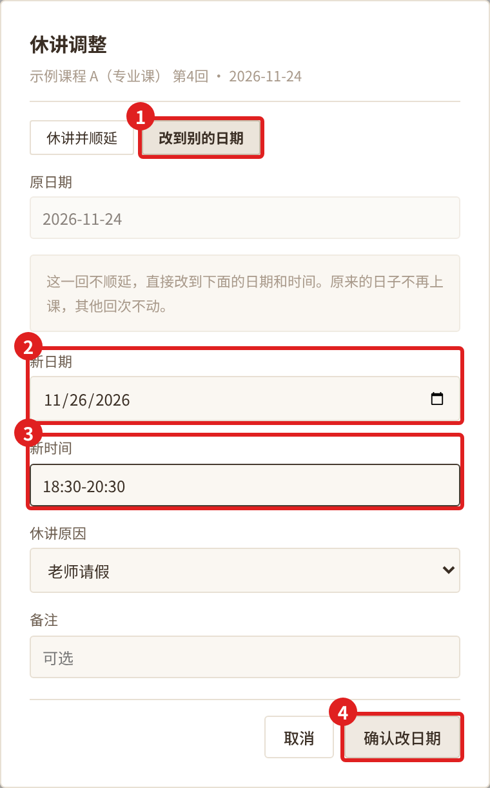

**做完后会看到**

1. 弹出「课程已修改，请核对」，里面写着 `第 4 回 11/24 → 11/26 18:30-20:30（老师请假）`，以及黄字 `单回日期有变动（改期 / 休讲顺延 / 新增课次），可能影响腾讯会议安排，请到排课系统确认`。
2. 同时检查新日子的教室，有两种结果：
   - 原教室空着：页面最上面一条绿色提示，什么都不用做。
   - 原教室被占，或这门课还没排教室：弹出「这几回的教室需要处理」，处理办法见 3.4。
3. 课程安排里，那一格变成新日期，旁边写着「（原 11/24）」，还多出「撤回」「再调整」两个小按钮。

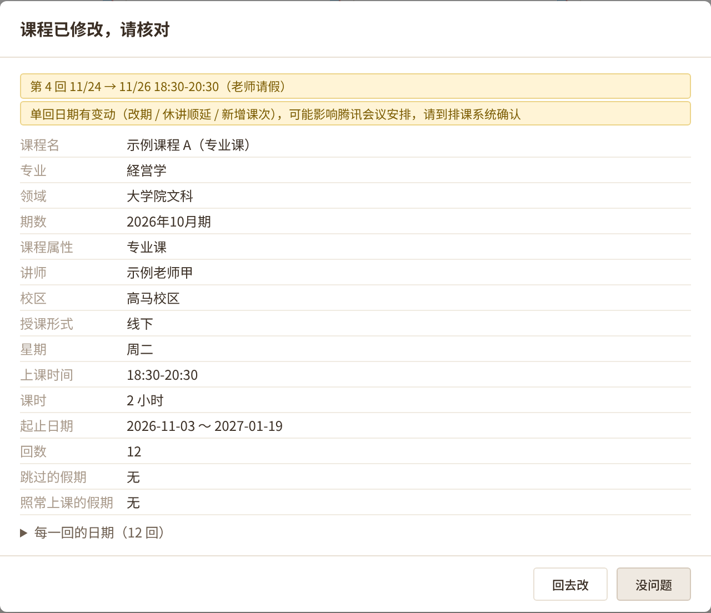

**注意**

- 如果新日期这门课已经有一回，系统会问：`这一天已经有第 N 回，仍要改到这一天吗？`
- 日期和时间都没变时，会提示 `日期和时间都没变`。
- **需要教室的大课，改完日期一定要看一眼教室**：要么当场选一间空教室，要么点「交给总务」。什么都不点就点「完成」的话，这一回保持原样，课程安排里会显示「被占 / 未排教室」。
- 课程表（排课系统）的格子**不会**跟着这一回的新日期变，详见目录里的「改了之后，哪里会变」。

### 3.2 这一回休讲

**什么时候用**：某一天不上课，并且要补一回。

**步骤**

1. 管理端 → 「课程安排」→ 点那一回格子上的「⇄」。
2. 在「休讲调整」里确认选中的是 ①「休讲并顺延」。
3. ② 「补课日期」：系统默认填最后一回之后的下一个上课日（跳过假期），可以改，但必须在最后一回之后。
4. ③ 「补课时间」默认是最后一回的时间，可以改。
5. 选「休讲原因」，点 ④「确认休讲并顺延」。
6. 系统再确认一次，写着 `确认将 2026-12-01（第5回）标记为休讲？` …… 点确定。

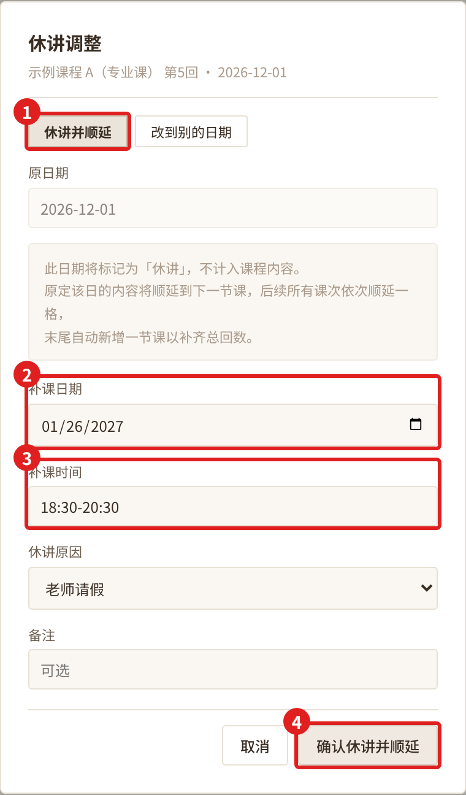

**做完后会看到**

- 提示 `已将 2026-12-01 标记为休讲，内容顺延，末尾 2027-01-26 补第 12 回。`
- 休讲那一天的格子划线，写着「休讲・老师请假」，右上角有「撤回」。
- 休讲那天原本的内容（标题、老师）整体往后顺延一回，**末尾多出一回**用来补课，总回数不变。
- 然后同 3.1：「课程已修改」核对窗和教室确认（休讲那天不再用教室；补课那一回要查教室）。

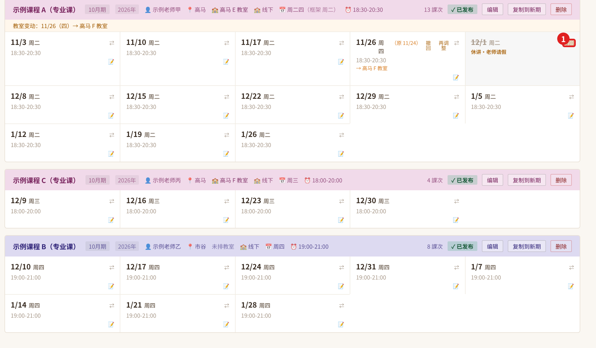

**注意**

- 同一系列的课（接续 / 同日分段）休讲时，窗口里会多出「这一天整个系列」等选项，并列出后面成员的变动，按提示选择即可。

### 3.3 这一回换老师

**什么时候用**：老师有变动。

**步骤（整门课换一位老师）**

1. 管理端 → 「课程安排」→ 卡片上的「编辑」。
2. 把「讲师」改成新老师。
3. 点「保存并生成课次」。

**做完后会看到**

- 只有一位老师的课：除休讲外，每一回的老师都改成这一位。
- 有多位老师的课：弹出 `上课老师已改，请在单回明细里重新分配老师（按周几 / 回数分配，或者去排课）`。请在编辑窗口里勾选「需要单回明细（逐回安排老师或主题）」，在表格里逐回改老师。

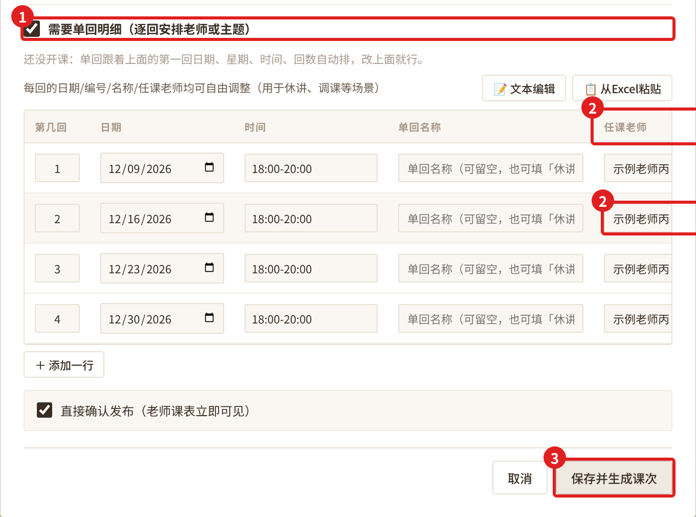

**注意**

- 换老师不影响教室，也不会弹教室确认窗口。
- 只想换某一回的老师：编辑课程 → ① 勾选「需要单回明细（逐回安排老师或主题）」→ ② 在表格里改那一行的「任课老师」→ ③ 点「保存并生成课次」。

### 3.4 这一回换教室

教室有两种办法，看你想自己定还是交给总务。

**办法一：你自己选一间空教室**

只有在改了日期 / 时间之后弹出的「这几回的教室需要处理」窗口里才能选。

1. 窗口里每一回一块：写着 `E 教室　被《示例活动》（示例使用人，18:00-21:00）占着`，或者「这门课还没排教室」。
2. 下面一排教室标签，前面带 ✓ 的是这个时间空着的。① 点一间。
3. 系统问 `第 4 回 11/26 改在 高马 F？`，点确定。
4. 这一回变成 `已安排在 高马 F ✓`。
5. 全部处理完，点 ④「完成」。

**办法二：交给总务**

- ② 点这一回右边的「交给总务」；有好几回就点窗口底部的「全部交给总务」。变成 `已交给总务 ✓`。
- 总务那边会收到「需要协调教室」（见目录「总务」里的「收到「需要协调教室」」）。
- 同一门课的同一回，不管你改几次日期，总务只会收到**一条**，以最后一次为准。

**办法三：先放着**

- ③ 「稍后调整另一门」：占着教室的另一门课，你打算先去调整它。页面上方会留一条黄色提示，等冲突消失后自动消失。窗口底部有「全部稍后处理」。

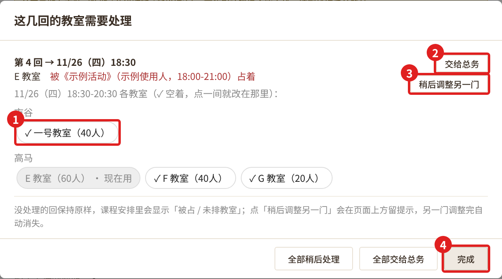

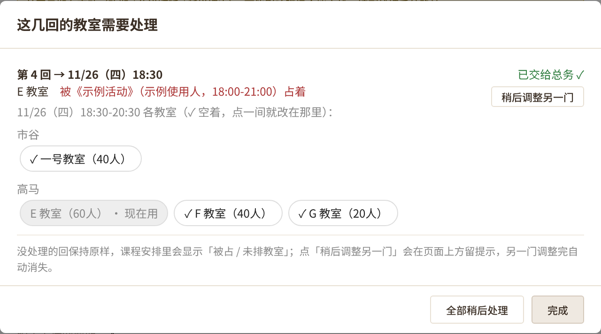

**做完后会看到**

- 换了教室的那一回，格子下面写着 `→ 高马 F 教室`；课程卡片上有一行 `教室变动：11/26（四）→ 高马 F 教室`。
- 没处理的回保持原样，卡片上显示红色小字「未排教室」。

**注意**

- 只想换教室、不改日期时，课程安排里**没有**专门的按钮。请联系总务（总务用「教室占用录入」里的「释放这一回的教室」，见 4.4）。

### 3.5 撤回刚才的调整

**撤回改日期**

1. 找到改过日期的那一格（写着「原 11/24」）。
2. 点格子上的「撤回」。
3. 系统问 `把第 4 回改回原来的 11/24 18:30-20:30？`，点确定。
4. 提示 `已把第 4 回改回 11/24 18:30-20:30。`，然后再检查一次教室（和 3.1 一样）。
5. 想再改到别的日子，点「再调整」。

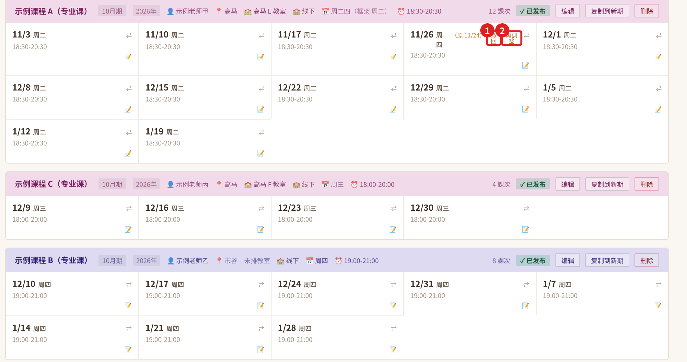

**撤回休讲**

1. 休讲那一格点「撤回」。
2. 系统提示：这天恢复上课，之后每一回的内容整体前移一位，最后一回（补课那回）会被删除。点确定。
3. 如果最后一回已经有出席或作业记录，会提示 `无法撤回：最后一回（…）已有出席/作业记录，不能删除。`，不能撤回。

**撤回后，哪些提示会消失**

- 页面顶部「教室协调」里这一回的「等总务处理」「需要你调整」「已处理」：**刷新课程安排页面后自动消失**（系统会核对这一回现在的日期和教室）。
- 总务首页「需要协调教室」里这一回的卡片：总务那边刷新后会重新核对，不再需要处理的会自动消失。

**注意**

- 撤回休讲后，系统不会弹教室确认窗口。如果那一天原来用的是单独换过的教室，请告诉总务看一下（待确认）。

### 3.6 课程安排页顶部的「教室协调」

改过日期、时间或休讲之后，课程安排页顶部可能出现「教室协调」框，有三种内容：

| 你看到的 | 意思 | 你要做什么 |
|---|---|---|
| 红字「等总务处理」，例如 `示例课程 A　第 4 回 → 11/26（四）18:30　E 教室 被《示例活动》（示例使用人，18:00-21:00）占着　等总务处理` | 你点过「交给总务」，总务还没处理 | 不用做，等 |
| 红色一块「需要你调整」，写着「无法安排教室」 | 总务试过了，这个时间所有教室都排不了，把球踢回给你 | 去改日期或时间（见下） |
| 绿字「✓ 11/26（四） 第 4 回 → 高马 F 教室（总务 示例总务，11/21）」 | 总务已经排好了，保留 7 天 | 不用做；看过后点右边的「知道了」收起 |

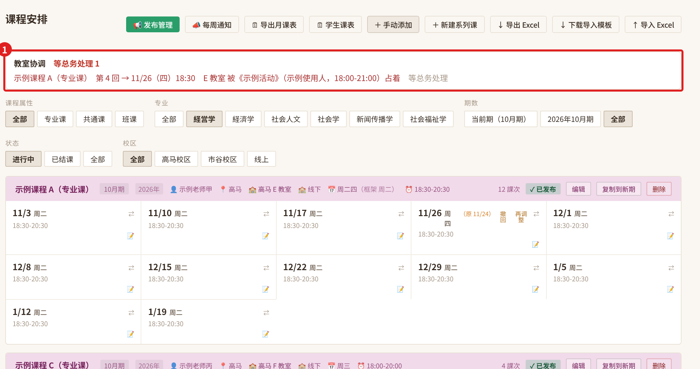

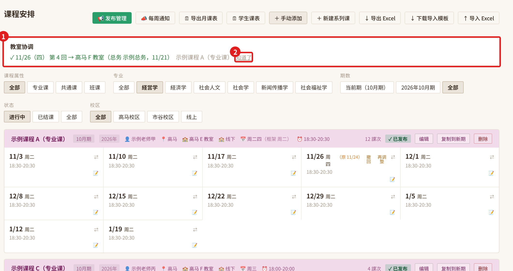

**特别说明：「需要你调整」**

框里会写：`「示例课程 A」第 4 回 11/26（四）18:30 无法安排教室（教室 E 教室 被「示例活动」占用）。可改为：当天 16:00-18:00 / 20:30-22:30；11/27（五）同时段；换到 市谷 校区。请在课程安排里调整日期或时间（改好后这条提示会自动消失）。`

- 「当天 16:00-18:00」：同一天换个时间段（按离原时间最近排，最多 3 个）。
- 「11/27（五）同时段」：换一天，时间不变（只列今天以后、这门课自己没课的日子，最多 3 个）。
- 「换到 市谷 校区」：换校区上课。要先和学生、老师确认，校区在「编辑」里改。
- 建议只表示那个时间有空教室，不保证老师、学生都方便，**最后由你决定**。

怎么改：按 3.1，点那一回的「⇄」→「改到别的日期」→ 填新日期 / 新时间 → 确认。改好后，这条红色提示**不用手动关**，刷新课程安排页面就自动消失；总务那边这一回也会自动变回「需要安排教室」或者消失。

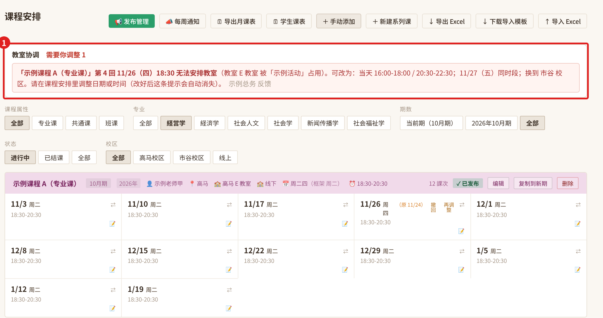

---

## 四、总务

### 4.1 新课要排教室

**什么时候用**：首页「排课提醒」里出现了未排教室的课。

**步骤**

1. 排课系统首页 → 「排课提醒」→ 点右边「展开 ▾」。（图 ④）
2. 展开后，每门课一行，写着老师、星期、时间、校区、开课日。点那一行的「去排」（图 ③）；想一口气排完，点「全部去排」。
3. 弹出「排「示例课程 B（专业课）」教室」。① 在「选教室（容量足够）」下拉里选一间。
4. 默认会占用该教室绑定的腾讯会议账号；不需要就点掉「占用该教室腾讯账号」。
5. ② 点「确认排入」。

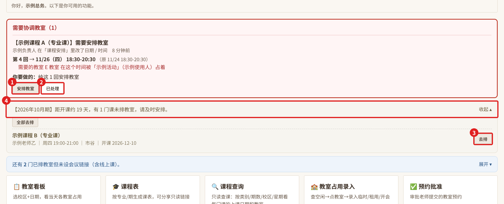

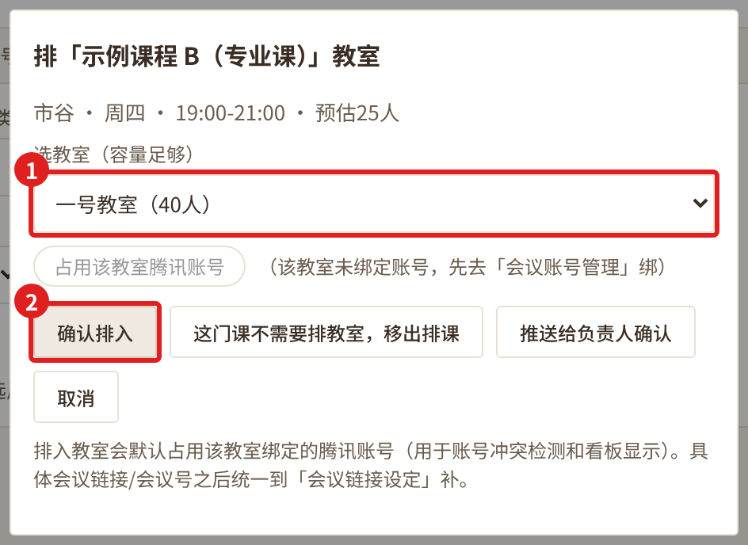

**做完后会看到**

- 提示 `已排入「一号教室」，可继续排下一门`。
- 管理端「课程安排」里这门课卡片上的「未排教室」变成教室名。

**注意**

- 这个窗口里还有：「清空教室（改回未排）」「这门课不需要排教室，移出排课」「推送给负责人确认」「取消」。
- **线上课**：教室不是必须的。点「仅腾讯会议（不占教室）」；学生要来教室自习时，点「学生要来自习，另占一间教室」。
- 如果窗口提示「这门课还没有日期，请先在管理端『课程安排』填好，不能排」，请联系负责人补日期。
- 首页还可能有蓝色提示 `还有 N 门已排教室但未设会议链接（含线上课）。`，点「会议链接设定」去设置。

### 4.2 收到「需要协调教室」

**什么时候用**：负责人改了日期 / 时间，并且点了「交给总务」；或者这一回原来的教室被释放了。首页最上面出现红色框「需要协调教室（N）」。

**一门课一张卡，怎么读**

- 标题：`【示例课程 A（专业课）】需要安排教室`。
- 第二行：谁在「课程安排」里改了日期 / 时间，多久之前。
- 每一回一块：`第 4 回 → 11/26（四） 18:30-20:30（原 11/24 18:30-20:30）`，下面红字写原因：
  - `需要的教室 E 教室 在这个时间被「示例活动」（示例使用人）占着`；
  - `这一回还没有排教室`；
  - `原 E 教室 教室已释放，……`：这一回原来单独换的教室已经释放了，需要确认或重新安排。
- 最后一行：`你要做的：给这 1 回安排教室`，两个按钮：「安排教室」「已处理」。

**步骤：一次换好**

1. ① 点「安排教室」。
2. 弹出「「示例课程 A（专业课）」安排教室」，顶部列出每一回的现状。系统已按「同校区、容量够、优先原教室」排好顺序。
3. 看 `这 N 回全部空闲的教室（点一间，N 回一次换好）`，① 点一间。
4. 系统问 `把这 N 回（11/26）都安排在 高马 F 教室？只改这门课这几天，高马 F 教室 的其他课不受影响。`，点确定。
5. 提示 `已为 N 回安排 高马 F 教室 教室`，页面上方的绿条有「撤销」按钮，点了可以改回去。

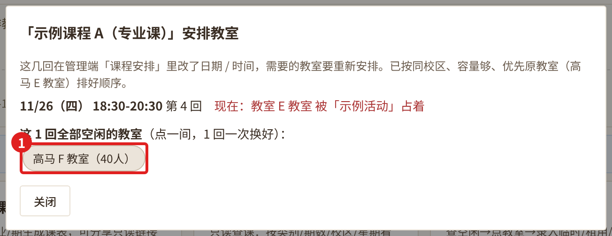

**只有个别天不行时**

- 如果没有一间教室能覆盖全部：窗口写 `没有一间教室能覆盖全部 N 回。最多能覆盖 x/N 回（点一间，换这 x 回）`，点一间先换这几回。
- 下面「下面这 N 天不能统一，单独安排」，每天单独列出空教室，一天一天点。
- 某一天一间空教室都没有：那一天旁边有按钮「无法安排教室，反馈给老师」（见 4.3）。

**遗留占用**

- 如果教室是被「别的课以前留下的占用」挡住的，卡片会说：`这是「某某课」以前留下的占用，它这天已经没有课（11/23）。`，旁边有按钮「清理这门课的遗留占用（N 条）」。点了就清掉，卡片重新核对。
- 首页也可能有灰色提示：`有 N 条遗留占用……建议清理`，点「查看并清理」。

**「已处理」按钮**

- 卡片上的「已处理」是告诉系统这张卡不用再提示了。只在你已经另外处理好（例如在别的页面排好了）时才点。

### 4.3 实在排不了：反馈给老师 / 负责人

**什么时候用**：这个时间所有教室都被占了。

**步骤**

1. 在「安排教室」窗口里，点 ① 「无法安排教室，反馈给老师」（整门课都排不了时点底部那个；只有某一天排不了时点那一天旁边的）。
2. 系统问 `反馈给老师：这 N 回无法安排教室？会附上可改的时间 / 日期 / 校区建议，由调整人在课程安排里改。`，点确定。

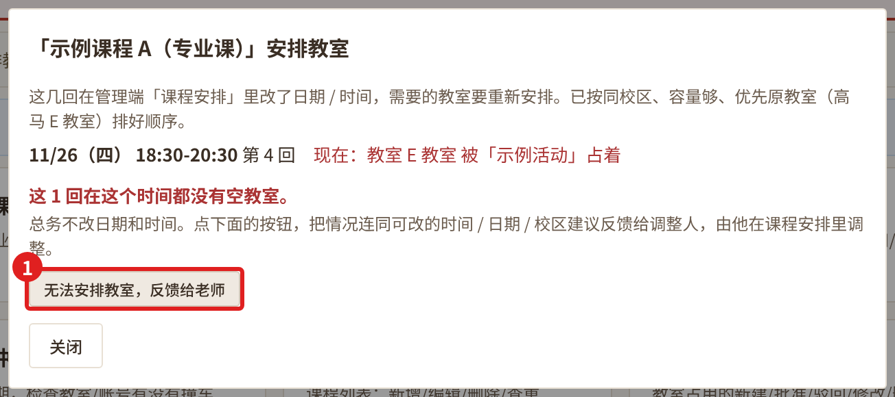

**做完后会看到**

- 提示 `已反馈给老师（1 回），等待调整`。
- 首页这张卡变成灰色：`教室协调：已反馈给老师，等待调整（1）`，不再算待处理。
- 负责人那边：课程安排页顶部出现红色「需要你调整」，并带着替代建议（当天其他时段、就近日期同时段、其他校区）。负责人改好日期或时间后，这条自动消失；你这边这一回会自动回到「需要安排教室」，或者（已有教室）直接消失。

**注意**：总务不改日期和时间，只反馈。

### 4.4 教室占用录入里「释放这一回的教室」再重新占用

**什么时候用**：一门课（大课）的**某一回**要换一间教室，或者连日期、时间一起换，而你想当场处理。只影响这一回，这门课其他回不动。

**需要什么权限**：「教室占用录入」的管理权限。没有这个权限，点网格里的课程占用格不会有反应。

**步骤**

1. 排课系统 → 「教室占用录入」。
2. 选好校区和日期，下面网格里能看到那一天各教室的占用。（图 ①）
3. 点网格里那门课的占用格（鼠标放上去提示：`点击：释放这一回的教室，重新占用别的教室`）。
4. 弹出「释放这一回的教室」，写着课程名、第几回、日期时间、教室、老师。① 点「释放并重新占用」（不想继续点 ②「取消」）。
5. 页面上方出现黄色提示：`E 教室 教室已释放。请重新占用别的教室：示例课程 A（专业课） 第 3 回，原 11/17 18:30-20:30。……`，并且下面自动查好了这个时间的空教室。
6. 在空教室那一行点「录入占用」（图 ③）。弹出的窗口里，**课程名、老师已经预填好了**，窗口上方还有黄条 `被释放的课程：……已释放。占用后按课程记录，并同步回课程安排。`
7. 需要换日期 / 时间的话，改页面上方的日期 / 开始 / 结束，点「查空闲」，再点「录入占用」。
8. 如果窗口里有「录入人姓名」，填你自己的真实姓名（会记在操作记录里）。
9. 点「保存占用」。

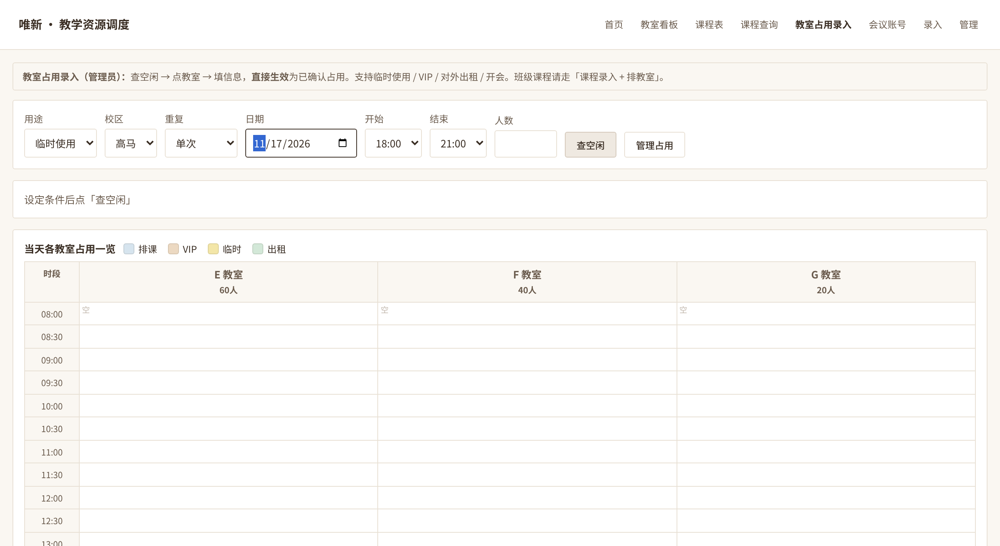

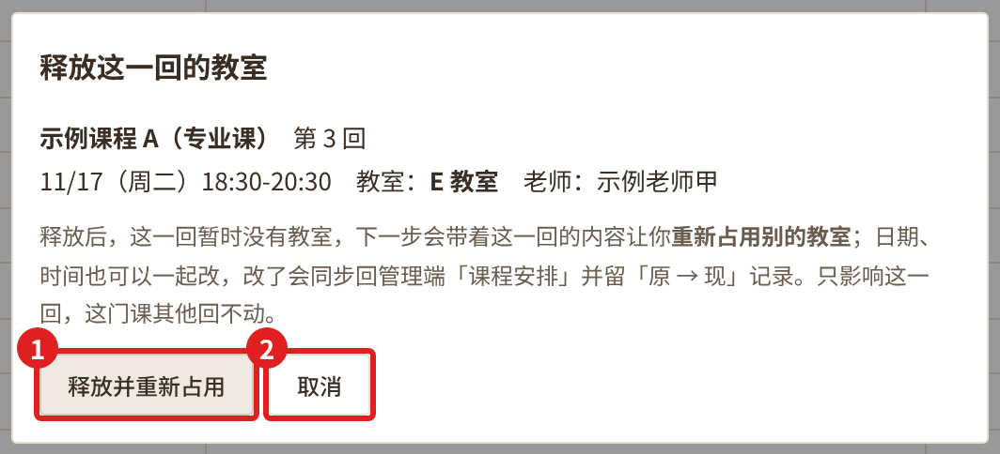

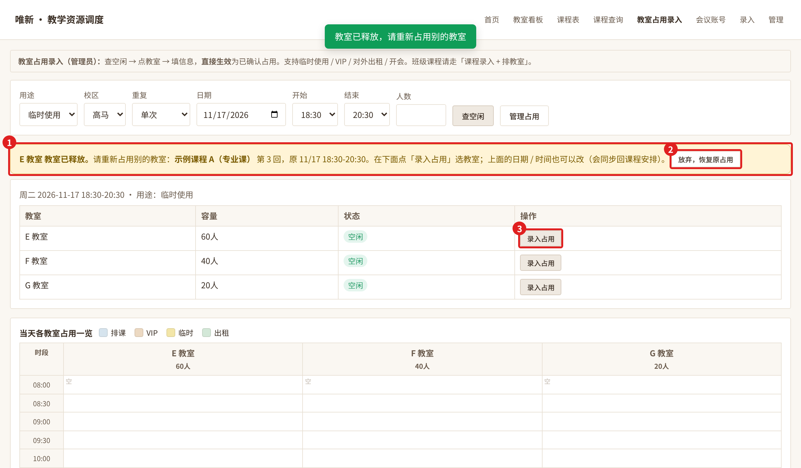

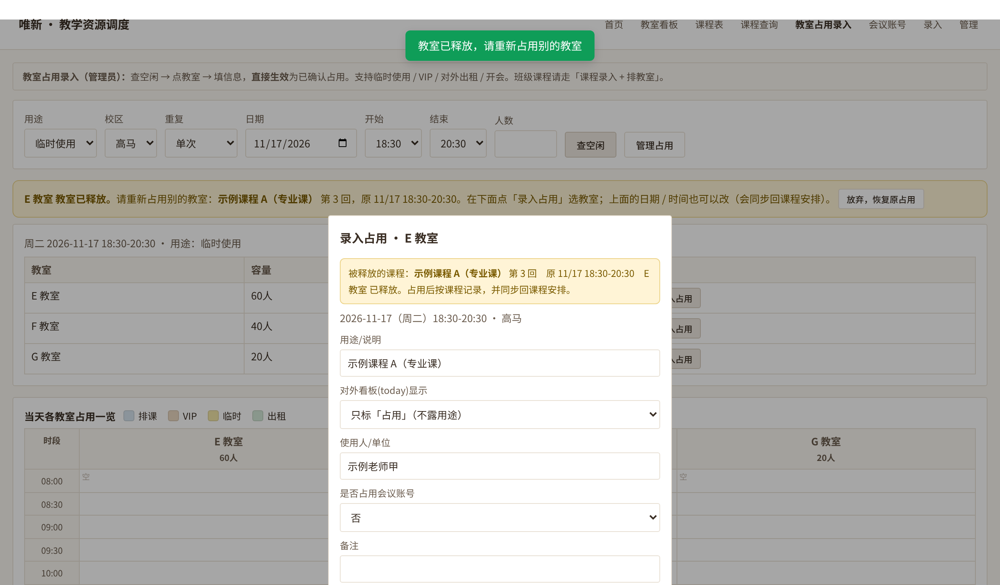

**做完后会看到**

- 提示 `已录入并生效（已同步到课程安排）`。
- 如果日期或时间变了：管理端「课程安排」里那一回会同步改成新的日期 / 时间，写着「（原 …）」，并留一条修改记录。如果只是换了教室，会留一条「换教室」记录。

**放弃**

- 释放之后想反悔：点黄色提示条右边的「放弃，恢复原占用」，系统问 `恢复原来的教室占用？`，点确定，原来的占用就恢复了，提示 `已恢复原占用`。
- 一次只能处理一回。上一回还没占用完就点下一个，会提示 `上一回还没占用完：请先占用别的教室，或点「放弃」恢复`。
- 如果那一天在「课程安排」里没有这一回，会提示 `这门课 … 在课程安排里没有这一回，请到管理端「课程安排」处理`。

### 4.5 总务不能做的事

- 不能改日期、不能休讲、不能顺延。排课系统里没有这些按钮。
- 要做这些，请联系学科负责人，让他在管理端「课程安排」里改。
- 排课系统「课程管理」里，只有开课前的课能改周几 / 开课日 / 回数；已开课的课按每一回调整，同样要找负责人。

---

## 五、改了之后，哪些地方会变

**读表方法**：左边是谁做了什么，右边是各个地方会怎样。「提示」是系统里会出现的原文。

| 你做了什么 | 课程表（排课系统） | 学生课表 | 管理端课程安排 | 教室安排（看板 / 今日） |
|---|---|---|---|---|
| **开课前，改整门课**（星期、开课日、回数、时间） | 格子按新的星期 + 开课日 ~ 结课日重新画 | 每一回按新日期（待确认：学生课表读课程安排里每一回的日期） | 每一回按新规则重排；提示 `已改：第 N 回 → …`，或「这几回的教室需要处理」；再有「课程已修改，请核对」 | 总务排好的每周教室记录不会自动改。提示：请告诉总务确认；时间变了还有黄字 `课程时间改成 … 了，排课里的每周教室占用还是 …，请到排课调整` |
| **这一回改日期 / 时间** | **格子不变**（还在原来的日期）。只在「单回调整说明」里写「原 → 现」 | 这一回显示新日期 | 格子显示新日期 + 「（原 11/24）」；提示「课程已修改，请核对」+ 教室确认 | 新日期按教室确认的结果显示；点了「交给总务」才会有总务那边的卡片 |
| **这一回休讲** | 休讲日划线显示「休讲」；补课那一回如果不在这门课的固定星期上，格子里没有（见下面说明） | 休讲日不显示，顺延后的新日期显示 | 休讲格划线、「休讲・原因」；末尾多一回；提示「已将 … 标记为休讲」 | 休讲那天不再占教室；补课那回走教室确认 |
| **这一回换教室**（选空教室） | 不变（课表格子不显示教室） | 不变 | 格子下写 `→ 高马 F 教室`；卡片 `教室变动：…`；若撞车，页面上方黄条 `11/26 第 4 回在 F 教室 跟《…》… 撞了，调整另一门以后会自动消失。` | 按新教室显示 |
| **撤回改日期** | 不变（本来就没跟着变） | 回到原日期 | 回到原日期，「（原 …）」消失；再查一次教室；「教室协调」里这一回的提示自动消失 | 回到原日期；原教室空着就沿用 |
| **总务释放这一回的教室再重新占用** | 不变（日期没变时）；日期变了，只在「单回调整说明」里写 | 日期 / 时间变了就跟着变 | 日期 / 时间同步成新的，写「（原 …）」并留修改记录；只换教室也留记录 | 原教室释放，新教室占用 |

### 课程表为什么不跟着这一回变

**课程表（排课系统「课程表」页面）的格子，是按「星期 + 开课日到结课日 + 休讲日」推算出来的「标准版」，不读每一回的实际日期。**

- 所以改了某一回的日期，课表格子**不会**跟着变，仍然画在原来的日子。
- 临时调整，写在课表页面的「单回调整说明」里：点旁边的「自动生成」，会按所选课程的每一回，列出 `第 N 回：11/24（二）→ 11/26（四）`、新增、教室变动，可以再手动修改，印在每页底部。
- 休讲（休讲并顺延）会把休讲日记进课程，课表里这一天划线显示「休讲」；但补课那一回只会在日期正好落在这门课固定星期上时才有格子，否则只在「单回调整说明」里出现。
- 以上是按目前系统的实际做法写的：课表格子由「星期 + 开课日到结课日 + 休讲日」推算，不读每一回。上线后如果课表改成读每一回，这一段要改。

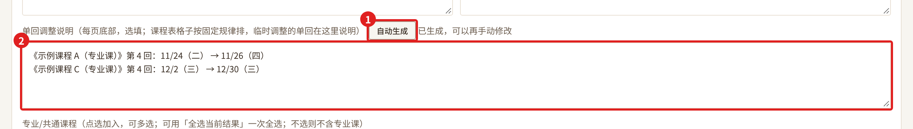

---

## 六、常见问题

**1. 「教室协调」里的提示为什么没消失？**
提示以这一回现在的日期和教室为准，不靠手动关。改完日期或时间后，要**刷新课程安排页面**才会重新核对。绿色「已处理」那一行可以点右边的「知道了」收起。

**2. 回数审查为什么说「需调整」？**
因为按周几、回数、假期推算出来的结课日，和课程里记的结课日不一样。命中假期/休讲那一列写了是哪几天遇到的。点「改回数 / 周几 / 开课日」调整。已开课的课不会出现在这里。

**3. 总务看不到某个按钮怎么办？**
「教室占用录入」里点课程占用格释放教室，需要管理权限；「排课提醒」「安排教室」需要排教室的权限。看不到时，请管理员（Sensis）检查你的权限。总务本来就没有「改日期」「休讲」这两个按钮，这不是漏了。

**4. 撤回后，教室为什么没回来？**
撤回改日期会再查一次教室，空着就沿用，被占时会弹教室确认窗口。撤回休讲不会弹窗，也不会补教室；如果那一天原来是单独换的教室，请告诉总务看一下。

**5. 为什么教室占用里有「以前留下的占用」？**
以前某一回改期或休讲后，原日期的教室占用有时没有清掉，会挡住别的课。总务首页的卡片会指出来，点「清理这门课的遗留占用」就行。负责人不用自己处理。

**6. 同一回改了两次日期，总务会收到两条吗？**
不会。同一门课的同一回只保留最新一条。总务首页同一门课的多回会合成一张卡。

**谁该联系谁**

- 教室被占、没教室、遗留占用、会议链接：**总务**。
- 总务反馈「无法安排教室」：**负责人自己**在课程安排里改日期 / 时间。
- 页面报错、数据明显不对：**管理员（Sensis）**。

---

## 上线后需要核对

下面这些功能改动，本说明是按当前最新代码写的；如果它们后来又有改动，请对照复查：

1. 课程管理只管未开课的课：「开课状态」筛选、回数审查只审未开课、未开课可改周几 / 开课日 / 回数。**回数审查里的「去调整」「通知管理端」目前不存在**，如果之后加上，第二章 2.3 要补。
2. 总务「需要协调教室」改造：一门课一张卡、一次换好、反馈给老师。任务单里说的「全部换到 X」按钮，目前界面上是点一间教室再确认，第四章 4.2 按现状写；如果改成按钮，要改。
3. 「教室协调」已处理提示核对当前状态，加「知道了」：第三章 3.6。
4. 释放 / 恢复占用的报错和遗留占用修复：第四章 4.4「放弃，恢复原占用」的行为（修复前后可能不一样）。
5. 课程某一回改期 / 休讲 / 删除后，数据库自动释放原日期占用并留提示：这依赖一份数据库脚本，是否已经执行请确认；没执行的话，「原 X 教室已释放」这类提示不会出现。
6. 管理端和排课系统「开课前 / 开课后」的判断标准是否要统一（第一章）。
7. 撤回休讲是否要增加教室确认（3.5）。
